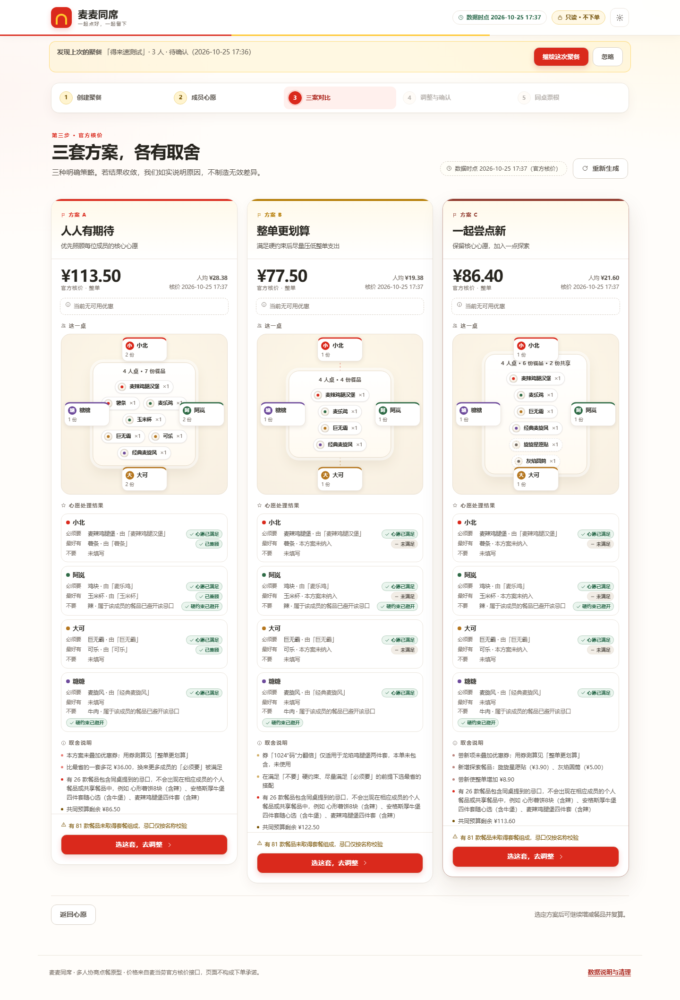
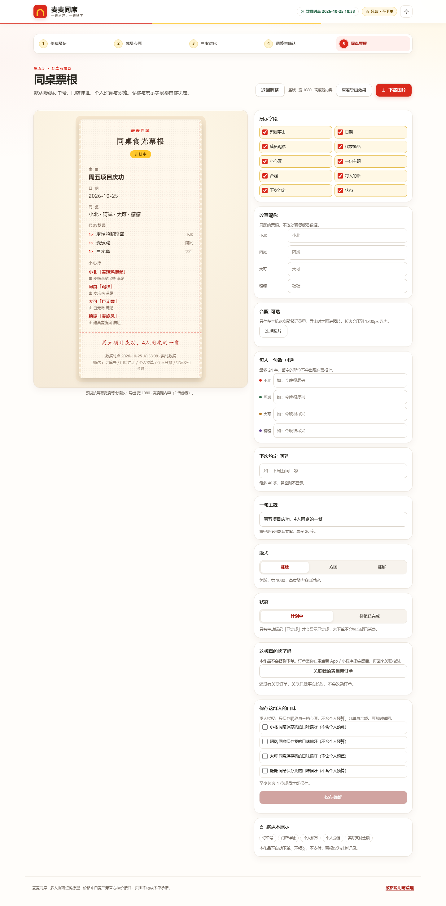
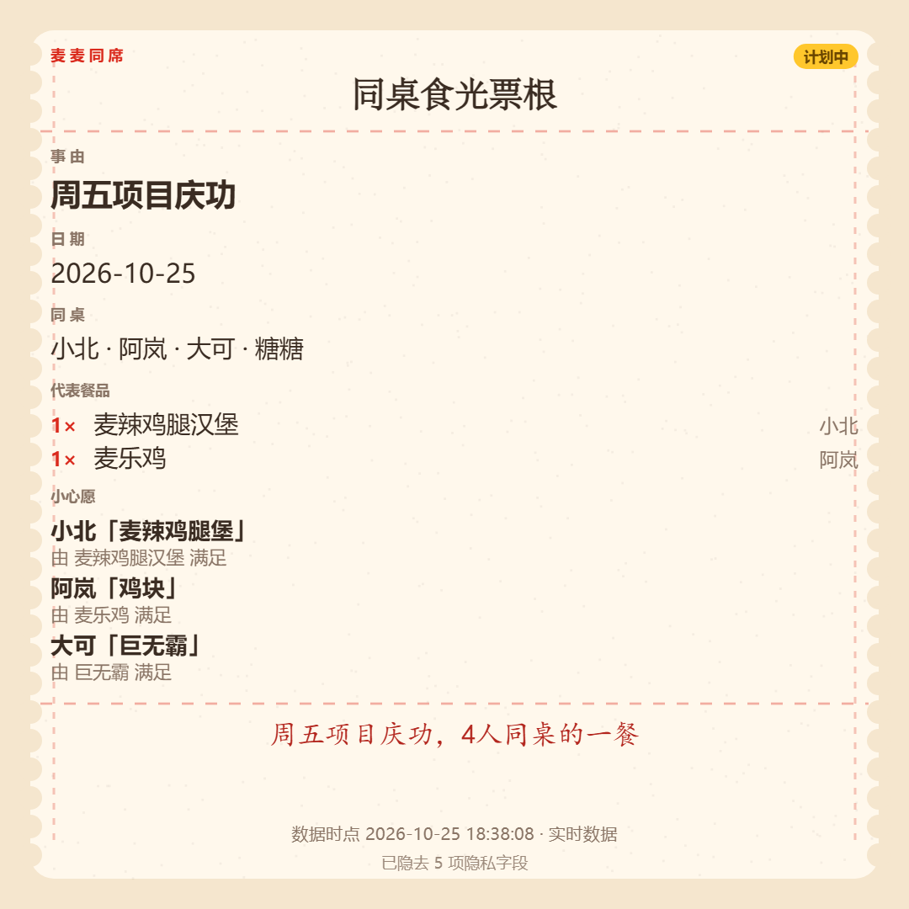
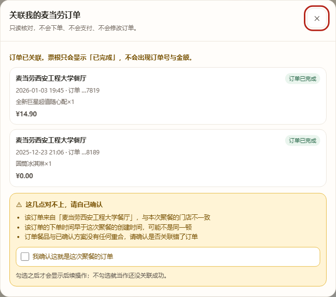

# 麦麦同席 · 使用与交付说明

> 多人协作点餐为主线、同桌食光票根为传播出口的麦当劳 MCP 参赛作品。
> 一句话：**先把这顿饭点好，再把这次相聚留下。**

## 30 秒讲清

3—8 人聚餐时，最难的不是找最低价，而是「谁想吃什么、谁不能吃什么、预算够不够」的反复沟通。
麦麦同席把这件事变成三张桌子：

1. 每人填三档心愿（**必须要 / 最好有 / 不要**），「不要」是硬约束；
2. 系统用**真实门店菜单 + 官方核价**给出三套策略不同的方案（人人有期待 / 整单更划算 / 一起尝点新），
   每套都说明「谁的心愿被满足、谁被调整、为什么这么取舍」；
3. 确认后一键生成**同桌食光票根**——带撕裂线的纸质票根，可直接下载分享，
   默认不含金额、门店详址和订单号。

## 目标用户

- **发起人**：办公室工作餐、项目庆功、宿舍拼单、朋友聚餐的组织者——不想在群里反复接龙统计「谁吃什么、谁不加辣、预算多少」。
- **参与成员**（通常 3—8 人）：想用结构化心愿（必须要 / 最好有 / 不要）代替长段文字，并看到自己的诉求被明确处理的人。
- **分享对象**：聚餐成员及用户主动选择的外部受众——票根默认脱敏，分享由用户自己决定。

## 运行

前提：Python 3.10+（无需任何第三方包），以及可用的麦当劳 MCP token。

```bash
git clone https://github.com/qinlinling/mcd-mcp-tablemate.git
cd mcd-mcp-tablemate

# 1) 配置 token（二选一）
#    a. 环境变量：set MCD_TOKEN=xxxxx（Windows）/ export MCD_TOKEN=xxxxx（macOS/Linux）
#    b. 或写入 ~/.workbuddy/mcp.json 的 mcpServers.mcd-mcp.headers.Authorization

# 2) 启动（无需 pip install，纯标准库）
python run.py            # 默认 http://127.0.0.1:8848，端口占用会自动 +1
```

> 仓库根目录就是项目根目录，所有命令都在根目录执行。`docs/` 中少数文档写于开发工作区
>（当时项目位于 `mmtx/` 子目录），其中出现的 `mmtx/xxx` 与这里的 `xxx` 指同一文件。

浏览器打开 `http://127.0.0.1:8848` 即可。首页有「填入标准演示场景」按钮，一键填好 4 人示例。

命令行自检：

```bash
python -c "from app.mcd_mcp import McdClient; c=McdClient(); print(c.health())"
python tests/e2e_smoke.py            # 端到端联调（会真实调用 MCP 只读接口）
python -m unittest discover -s tests -p "test_*.py"   # 单元测试（87 项）
node tests/ui_smoke.mjs        # 前端主流程冒烟（需先装 jsdom）
node tests/ui_p1_smoke.mjs     # 前端 P1 验收
node tests/export_sizes.mjs    # 票根三版式导出尺寸
node tests/screenshots.mjs     # 1440/390 双尺寸截图 + 溢出断言（输出到 docs/screenshots）
```

> 后 4 个是**开发期脚本**，需要 node 依赖（作品本身运行不需要）：
> `npm i -D jsdom puppeteer-core canvas`，或设置 `MMTX_DEV_MODULES` 指向已有这些包的 `node_modules`。
> 截图脚本还需要本机 Chromium 内核浏览器（Edge/Chrome），可用 `MMTX_BROWSER` 指定路径。

## 使用示例

一条完整的标准演示路径（4 人聚餐，约 3 分钟）：

**① 建聚餐**：打开首页 → 点「填入标准演示场景」→「查门店」→ 选第一家 → 设共同预算 200 元 → 「创建聚餐」。

**② 各自说心愿**：逐位填「必须要 / 最好有 / 不要」。例：小北要麦辣鸡腿堡、阿岚不吃辣、大可要巨无霸、糖糖不要牛肉。
系统会把口语匹配到菜单（例如「鸡块」→「麦乐鸡」），匹配不上的如实告诉你。



**③ 看三套方案**：人人有期待 / 整单更划算 / 一起尝点新。每套都给出整单官方核价、人均、
每件餐品归谁、每个人的心愿处理结果，以及「为什么这么取舍」。价格一律来自官方核价，页面顶部标数据时点。

**④ 调整并确认**：可增删餐品、改归属、改数量，每次改动都会重新核价（旧价立即作废）。
分账表按「归属 + 共享分摊 − 优惠分摊」计算，底部校验合计是否等于整单。确认只代表「保存为方案」，**不下单**。



**⑤ 生成票根**：可勾选展示字段、改昵称、加合照/每人一句话/下次约定，选竖版/方图/竖屏导出。
票根默认隐藏订单号、门店详址、个人预算与分摊。

| 方图导出（1080×1080） | 订单只读核对 |
|---|---|
|  |  |

**⑥ 下次再聚**：确认方案后可勾选成员「同意保存口味」→ 下次在第 1 步一键带入 →
系统按**当前菜单重新查、重新核价**，不沿用旧价格。

> 完整五步口播稿见 [`docs/演示脚本.md`](docs/演示脚本.md)；两档尺寸的逐屏截图见 [`docs/screenshots/`](docs/screenshots/)。

## 参赛材料清单

官方要求仓库根目录必须含以下文件（[活动说明](https://github.com/M-China/mcd-developer-innovation-challenge)）：

| 序号 | 文件 | 要求 | 本仓库状态 |
|---|---|---|---|
| 1 | `README.md` | 项目介绍、安装方法、使用示例、目标用户 | ✅ 四个要素齐备（含截图） |
| 2 | `CONTEST_DECLARATION.md` | 内容与官方**完全一致**，不可修改 | ✅ 与官方文件逐字节一致（1522 字节，sha1 匹配） |
| 3 | `MCP_INTEGRATION.md` | Server / Tool / 调用流程 / 业务价值 | ✅ 四部分齐备 |
| 4 | 源代码 | 形式不限 | ✅ `app/` `web/` `run.py`，零第三方依赖 |
| 5 | `workbuddy.md` | 非必须；参加 WorkBuddy 专项奖励时提交 | ✅ 已包含开发对话上下文 |

补充：`mcp-config.example.json` 仅含环境变量占位符 `${MCD_TOKEN}`，不含任何真实凭证。

## 目录

```
mcd-mcp-tablemate/
├── run.py                    启动入口（标准库，零依赖）
├── app/
│   ├── rules.py              聚餐/成员数据结构、忌口词表、心愿匹配、校验（B01）
│   ├── strategy.py           三类方案生成 + 手动调整后复算（B02/B05）
│   ├── allocate.py           餐品归属与分账口径（B03）
│   ├── explain.py            心愿处理结果与取舍文案（B04）
│   ├── mcd_mcp.py            麦当劳 MCP 客户端：JSON-RPC、缓存、降级、能力矩阵（C01—C04）
│   ├── ticket.py             票根字段映射与默认脱敏（D01/D03）+ 照片/一句话/下次约定
│   ├── preferences.py        成员偏好授权保存与「原班人马再聚」（P1-A）
│   ├── orders.py             真实订单只读关联与三项事实核对（P1-D）
│   ├── store.py              本地 JSON 存储与清理
│   └── server.py             REST API（ThreadingHTTPServer）
├── web/                      前端（原生 HTML/CSS/JS，无构建、无 CDN）
│   ├── index.html  styles.css  app.js  ticket.js
├── tests/
│   ├── test_engine.py        规则/分账/策略/复算回归（23 项）
│   ├── test_degrade.py       断网回放、核价失败、券不适用（3 项）
│   ├── e2e_smoke.py          端到端联调脚本（可留档证据）
│   ├── ui_smoke.mjs          前端运行时冒烟（开发期用 jsdom，作品本身不依赖）
│   ├── ui_p1_smoke.mjs       P1 前端独立验收（再聚/授权/增强/版式/订单）
│   ├── export_sizes.mjs      票根三版式真实 PNG 尺寸验证（需要 canvas 包）
│   ├── screenshots.mjs       真实浏览器双尺寸截图（Edge + puppeteer-core）
│   ├── cases.json            标准测试场景集（3—8 人、多冲突）
│   └── fixtures/             真实门店菜单快照（2026-10-25 抓取）
├── docs/                     阶段交付文档（需求清单、能力矩阵、规则说明、测试报告、演示脚本…）
└── work/agent-coordination/  多智能体协作状态、决策、冻结接口
```

## P1 增强（在 P0 闭环稳定后追加）

| 能力 | 说明 | 边界 |
|---|---|---|
| 原班人马，再吃一次 | 成员**逐人授权**后保存三档心愿；下次一键带入 | 只存心愿，不存个人预算/订单/金额；**必不沿用旧价格**，菜单与核价全部重查 |
| 票根增强 | 合照、每人一句话、下次约定 | 照片仅 jpeg/png/webp 且 ≤600KB；不接受外链与 svg |
| 多种版式 | 竖版 / 方图(1080×1080) / 竖屏(1080×1920) | DOM 预览按版式重排；「查看导出效果」按需出 1080 成品图 |
| 取餐方式 | 到店自取 + 得来速（需门店返回 beCode） | 外送/团餐未开放（需 `delivery-query-stores`，未验证） |
| 已完成 + 关联订单 | 只读查询自己的麦当劳订单并关联，做门店/时间/餐品三项核对 | **只读，绝不下单**；订单号只在本地，界面只显示后 4 位，票根完全不出现 |

## 只读优先与安全边界

| 项目 | 实现 |
|---|---|
| 自动下单 / 支付 / 领券 | **未实现，也不调用**。作品只调用门店、菜单、详情、优惠查询与核价 |
| 确认方案 | 仅保存为「聚餐方案」，页面明确提示「未下单、未支付」 |
| 数据存放 | 全部在本地 `.data/`，设置抽屉可一键清除（含缓存） |
| 票根默认隐藏 | 订单号、门店详址、个人预算、个人分摊、实际支付金额 |
| 接口失败 | 不估算价格；有历史快照则标「离线回放·非实时」，无则显示「不可用」 |
| 模型行为 | 不做营养/过敏原安全承诺，不推测未填写的偏好 |

## 交付证据

- `docs/screenshots/`：1440 与 390 两档的逐屏截图、票根三版式本体、真实导出 PNG、导出效果弹层、订单核对弹层（共 24 张）
- `docs/视觉核对记录.md`：逐屏人工核对结论 + 截图侧问题的修复说明 + 仍需真机确认的项
- `docs/可用性测试材料.md`：真人测试的任务脚本、观察表与判定标准（待执行）

## 数据与证据

- 门店菜单、核价、优惠均为**实时官方接口**，每次结果带 `dataTime` 与 `traceId`，页面顶部展示数据时点。
- 联调记录见 `docs/MCP联调记录.md`；接口能力与限制见 `docs/MCP能力矩阵.md`。
- 与项目规划的逐条对应关系、以及所有偏离项，见 `docs/实现与规划对照.md`。
